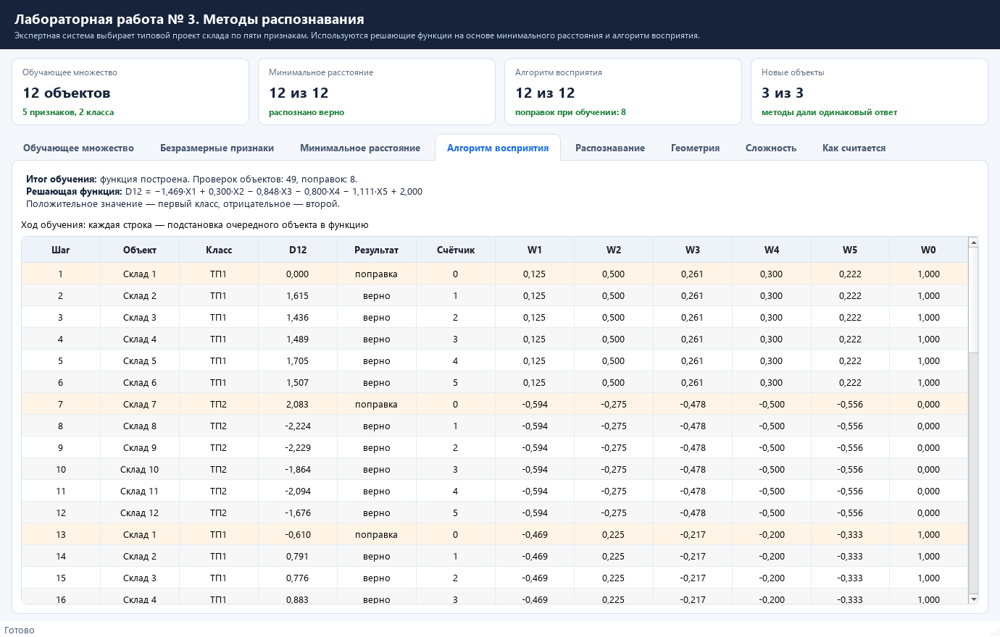
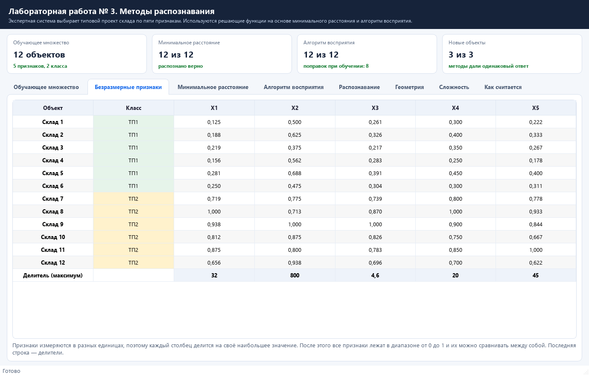
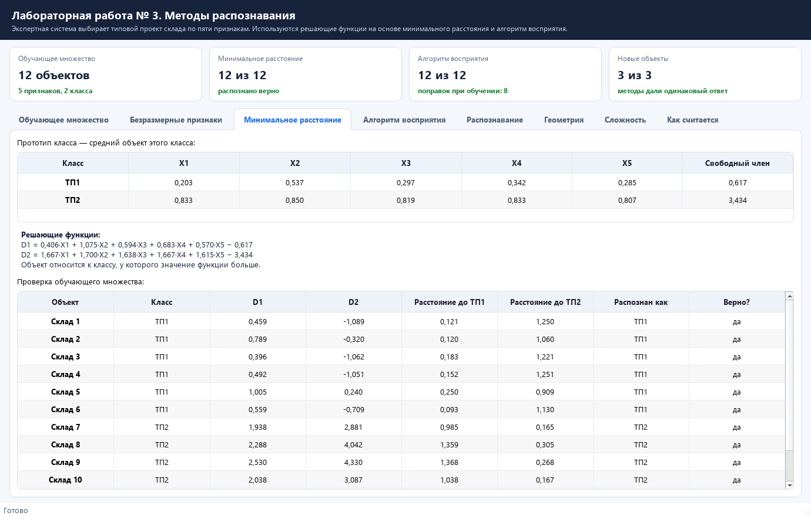
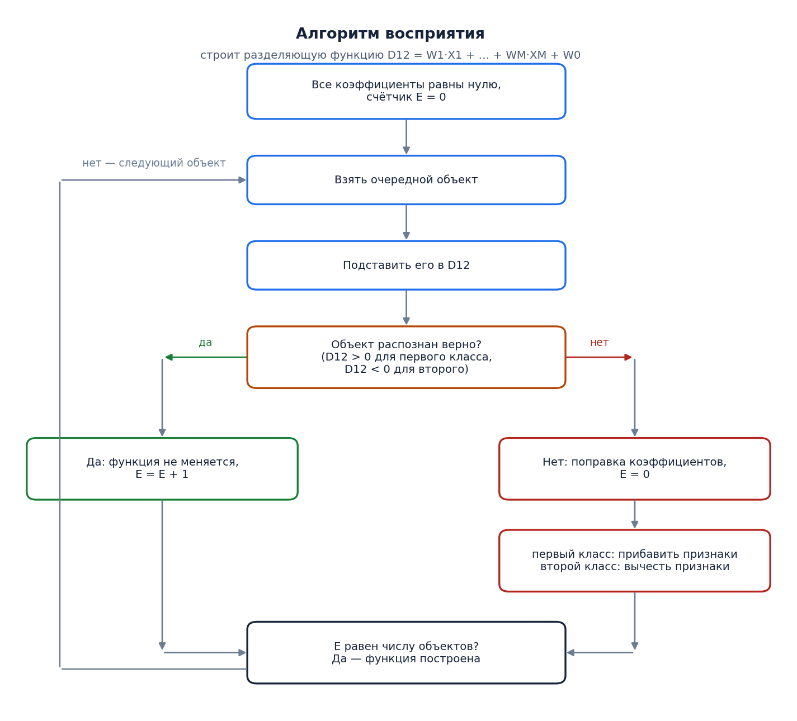
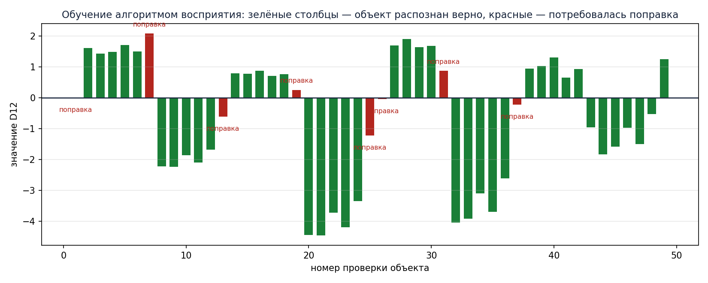
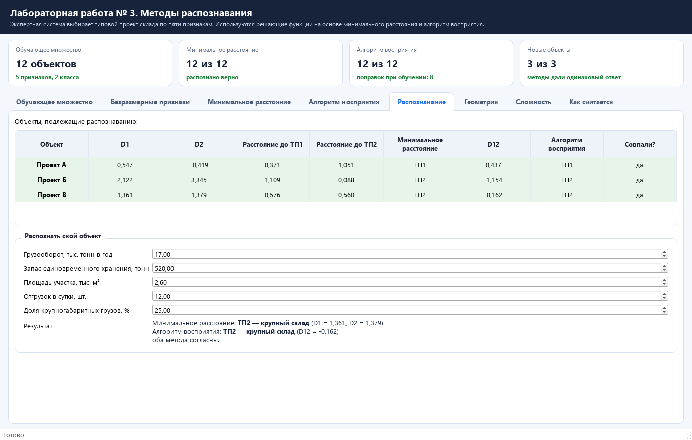
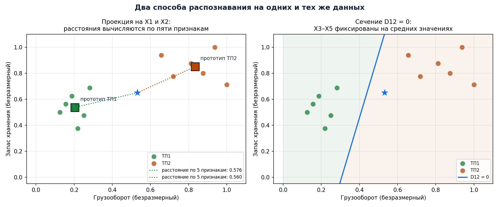
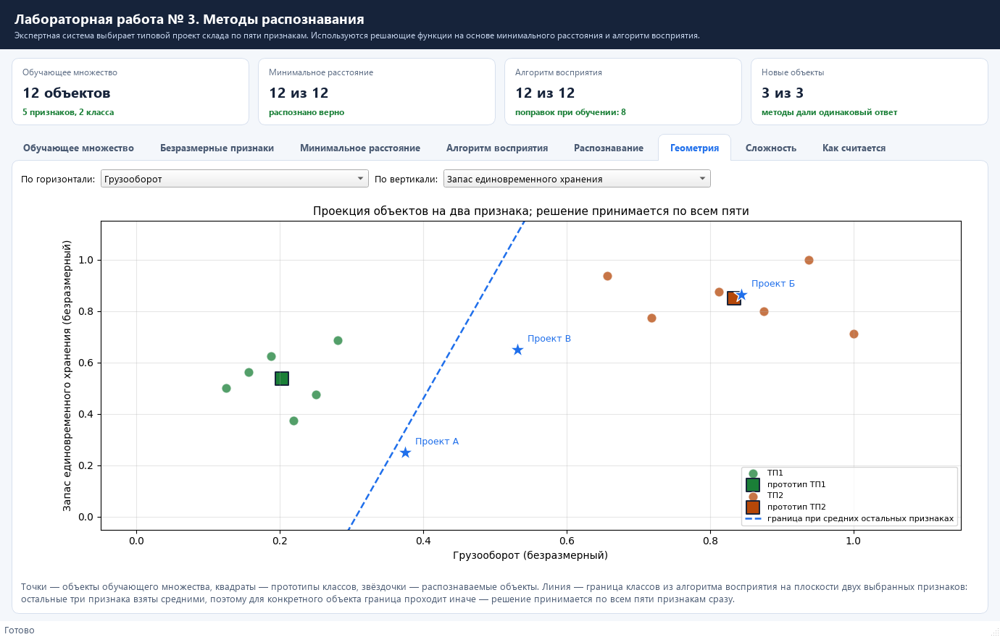
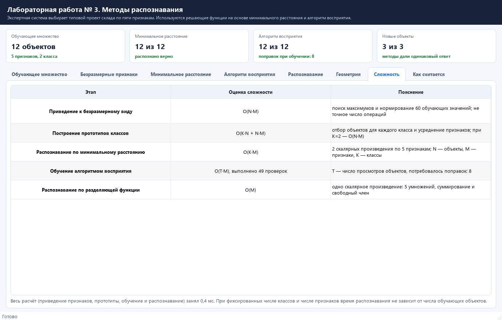
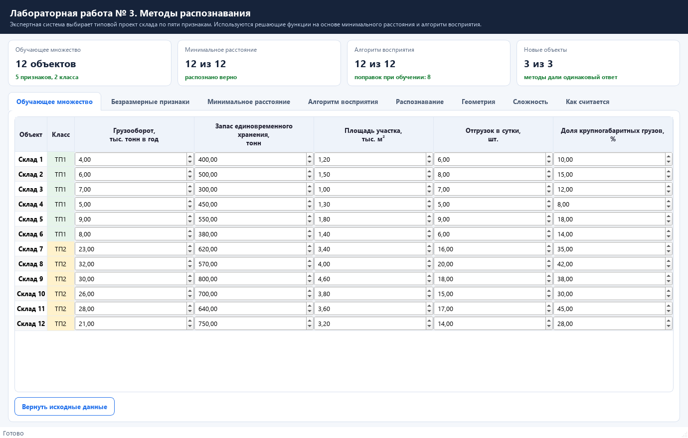

# Лабораторная работа № 3. Методы распознавания

Дисциплина «Базы знаний и принятие проектных решений в САПР», **вариант 3**.
Лабораторная работа № 3 соответствует лабораторной работе № 7 методического пособия `pract.pdf`.

Программа — учебная экспертная система: она выбирает типовой проект для нового склада.
Обучающее множество — двенадцать уже построенных складов двух типов, каждый описан пятью
признаками. Распознавание выполняется двумя способами: решающими функциями на основе
минимального расстояния и разделяющей функцией, построенной алгоритмом восприятия.



---

## Содержание

1. [Условие задачи](#условие-задачи)
2. [Быстрый старт](#быстрый-старт)
3. [Шаг 1. Приведение признаков](#шаг-1-приведение-признаков)
4. [Метод 1. Минимальное расстояние](#метод-1-минимальное-расстояние)
5. [Метод 2. Алгоритм восприятия](#метод-2-алгоритм-восприятия)
6. [Распознавание новых объектов](#распознавание-новых-объектов)
7. [Геометрия задачи](#геометрия-задачи)
8. [Вычислительная сложность](#вычислительная-сложность)
9. [Как пользоваться программой](#как-пользоваться-программой)
10. [Структура проекта](#структура-проекта)
11. [Тесты](#тесты)
12. [Ответ на вопрос задачи](#ответ-на-вопрос-задачи)

---

## Условие задачи

По заданию нужно создать обучающее множество не менее чем из десяти объектов, относящихся
к двум классам, задать объект с пятью признаками и распознать его двумя методами,
а затем оценить вычислительную сложность алгоритмов.

Предметная область взята из методического пособия и расширена: экспертная система
проектирования складов выбирает типовой проект. Классы — типовые проекты **ТП1**
(небольшой склад) и **ТП2** (крупный склад). Признаки:

| Обозначение | Признак | Единицы |
|---|---|---|
| X1 | грузооборот | тыс. тонн в год |
| X2 | запас единовременного хранения | тонн |
| X3 | площадь участка | тыс. м² |
| X4 | отгрузок в сутки | шт. |
| X5 | доля крупногабаритных грузов | % |

Обучающее множество — двенадцать складов, которые уже построены и успешно работают:

| Объект | Класс | X1 | X2 | X3 | X4 | X5 |
|---|---|---:|---:|---:|---:|---:|
| Склад 1 | ТП1 | 4 | 400 | 1,2 | 6 | 10 |
| Склад 2 | ТП1 | 6 | 500 | 1,5 | 8 | 15 |
| Склад 3 | ТП1 | 7 | 300 | 1,0 | 7 | 12 |
| Склад 4 | ТП1 | 5 | 450 | 1,3 | 5 | 8 |
| Склад 5 | ТП1 | 9 | 550 | 1,8 | 9 | 18 |
| Склад 6 | ТП1 | 8 | 380 | 1,4 | 6 | 14 |
| Склад 7 | ТП2 | 23 | 620 | 3,4 | 16 | 35 |
| Склад 8 | ТП2 | 32 | 570 | 4,0 | 20 | 42 |
| Склад 9 | ТП2 | 30 | 800 | 4,6 | 18 | 38 |
| Склад 10 | ТП2 | 26 | 700 | 3,8 | 15 | 30 |
| Склад 11 | ТП2 | 28 | 640 | 3,6 | 17 | 45 |
| Склад 12 | ТП2 | 21 | 750 | 3,2 | 14 | 28 |

Распознать нужно три проектируемых склада:

| Объект | X1 | X2 | X3 | X4 | X5 |
|---|---:|---:|---:|---:|---:|
| Проект А | 12 | 200 | 1,8 | 9 | 16 |
| Проект Б | 27 | 690 | 3,9 | 16 | 33 |
| Проект В | 17 | 520 | 2,6 | 12 | 25 |

---

## Быстрый старт

Нужен Python версии 3.10 или новее.

### Windows (PowerShell или командная строка)

```bat
git clone https://github.com/dezshev/BZiPPRvSAPR-labs.git
cd BZiPPRvSAPR-labs
git checkout lab3

python -m venv .venv
.venv\Scripts\activate

pip install -r requirements.txt
python main.py
```

### Linux или macOS

```bash
git clone https://github.com/dezshev/BZiPPRvSAPR-labs.git
cd BZiPPRvSAPR-labs
git checkout lab3

python3 -m venv .venv
source .venv/bin/activate

pip install -r requirements.txt
python main.py
```

Окно открывается сразу с готовым расчётом; значения признаков можно менять прямо в таблице.

| Пакет | Зачем |
|---|---|
| `PySide6` | окно программы, таблицы, вкладки |
| `matplotlib` | графики и геометрическая интерпретация |

---

## Шаг 1. Приведение признаков

Признаки измеряются в разных единицах: грузооборот — в тысячах тонн, запас хранения — в тоннах,
площадь — в тысячах квадратных метров. Складывать такие числа нельзя, поэтому каждый столбец
делится на своё наибольшее значение — способ, описанный в методическом пособии.

Делители: X1 — 32, X2 — 800, X3 — 4,6, X4 — 20, X5 — 45.

| Объект | Класс | X1 | X2 | X3 | X4 | X5 |
|---|---|---:|---:|---:|---:|---:|
| Склад 1 | ТП1 | 0,125 | 0,500 | 0,261 | 0,300 | 0,222 |
| Склад 2 | ТП1 | 0,188 | 0,625 | 0,326 | 0,400 | 0,333 |
| Склад 3 | ТП1 | 0,219 | 0,375 | 0,217 | 0,350 | 0,267 |
| Склад 4 | ТП1 | 0,156 | 0,562 | 0,283 | 0,250 | 0,178 |
| Склад 5 | ТП1 | 0,281 | 0,688 | 0,391 | 0,450 | 0,400 |
| Склад 6 | ТП1 | 0,250 | 0,475 | 0,304 | 0,300 | 0,311 |
| Склад 7 | ТП2 | 0,719 | 0,775 | 0,739 | 0,800 | 0,778 |
| Склад 8 | ТП2 | 1,000 | 0,713 | 0,870 | 1,000 | 0,933 |
| Склад 9 | ТП2 | 0,938 | 1,000 | 1,000 | 0,900 | 0,844 |
| Склад 10 | ТП2 | 0,812 | 0,875 | 0,826 | 0,750 | 0,667 |
| Склад 11 | ТП2 | 0,875 | 0,800 | 0,783 | 0,850 | 1,000 |
| Склад 12 | ТП2 | 0,656 | 0,938 | 0,696 | 0,700 | 0,622 |



---

## Метод 1. Минимальное расстояние

Для каждого класса строится **прототип** — «средний» склад этого класса:

| Класс | X1 | X2 | X3 | X4 | X5 | Свободный член |
|---|---:|---:|---:|---:|---:|---:|
| ТП1 | 0,203 | 0,537 | 0,297 | 0,342 | 0,285 | 0,617 |
| ТП2 | 0,833 | 0,850 | 0,819 | 0,833 | 0,807 | 3,434 |

Решающая функция класса записывается по формуле из пособия
**Di = 2·(X1·Pi1 + … + XM·PiM) − (Pi1² + … + PiM²)**, где M — число признаков:

```
D1 = 0,406·X1 + 1,075·X2 + 0,594·X3 + 0,683·X4 + 0,570·X5 − 0,617
D2 = 1,667·X1 + 1,700·X2 + 1,638·X3 + 1,667·X4 + 1,615·X5 − 3,434
```

Объект относится к классу, у которого значение функции больше. Это то же самое, что выбрать
ближайший прототип по обычному расстоянию, только считается быстрее: вместо корней и квадратов
нужны одно умножение и одно вычитание на класс.



Все двенадцать объектов обучающего множества распознаются правильно.

---

## Метод 2. Алгоритм восприятия

Второй метод строит одну разделяющую функцию **D12 = W1·X1 + … + W5·X5 + W0**: для складов
первого класса она должна быть положительной, для второго — отрицательной.



Коэффициенты начинаются с нуля, объекты перебираются по кругу. Первая же подстановка даёт
D12 = 0, то есть ошибку на объекте первого класса, поэтому к коэффициентам прибавляются
признаки «Склада 1», а W0 становится равным единице — ровно как в примере пособия.

Обучение заняло **49 проверок и 8 поправок**, итоговая функция:

```
D12 = −1,469·X1 + 0,300·X2 − 0,848·X3 − 0,800·X4 − 1,111·X5 + 2,000
```



Красные столбцы — проверки, после которых потребовалась поправка, зелёные — объект распознан
верно. Видно, что после каждой поправки счётчик правильных ответов сбрасывается и функция
проверяется заново, а к концу обучения все двенадцать объектов проходят подряд.

---

## Распознавание новых объектов

| Объект | D1 | D2 | Расстояние до ТП1 | Расстояние до ТП2 | Минимальное расстояние | D12 | Алгоритм восприятия |
|---|---:|---:|---:|---:|---|---:|---|
| Проект А | 0,547 | −0,419 | 0,371 | 1,051 | **ТП1** | 0,437 | **ТП1** |
| Проект Б | 2,122 | 3,345 | 1,109 | 0,088 | **ТП2** | −1,154 | **ТП2** |
| Проект В | 1,361 | 1,379 | 0,576 | 0,560 | **ТП2** | −0,162 | **ТП2** |

Оба метода дали одинаковые ответы. «Проект В» — пограничный случай: расстояния до прототипов
почти равны (0,576 и 0,560), и значение разделяющей функции тоже близко к нулю (−0,162).
Такой склад стоит рассматривать отдельно: он одинаково близок к обоим типовым проектам.



В нижней части вкладки можно ввести признаки своего склада и сразу увидеть ответ обоих методов.

---

## Геометрия задачи



Слева показаны проекции объекта и прототипов на X1 и X2. Расстояния для выбора класса
вычисляются по всем пяти признакам; длины отрезков в проекции не определяют класс.
Справа показано сечение D12 = 0 при средних значениях X3–X5. Положение реального объекта
относительно этой линии не заменяет вычисление функции по всем пяти координатам.

В программе оси можно переключать на любые два признака:



Линия границы на плоскости показана для случая, когда остальные три признака равны средним
значениям: решение принимается сразу по всем пяти признакам, поэтому плоская картинка —
только иллюстрация.

---

## Вычислительная сложность

| Этап | Оценка | Пояснение |
|---|---|---|
| Приведение признаков | O(N·M) | поиск максимумов и нормирование 60 значений |
| Построение прототипов | O(K·N + N·M) | отбор объектов по классам и усреднение; при K=2 — O(N·M) |
| Распознавание по расстоянию | O(K·M) | два скалярных произведения по пять признаков |
| Обучение алгоритмом восприятия | O(T·M), 49 проверок | T — число просмотров объектов, поправок 8 |
| Распознавание по границе | O(M) | пять умножений, суммирование и свободный член |

Здесь N — число объектов, M — число признаков, K — число классов; O обозначает порядок роста,
а не точное число арифметических операций. Для метода минимального расстояния обучение
состоит в вычислении прототипов без итерационного подбора коэффициентов. В текущем коде
объекты отбираются отдельно для каждого класса. Алгоритм восприятия обучается итерационно,
и его время зависит от того, насколько
«перемешаны» классы, зато готовая функция распознаёт объект за пять умножений.



---

## Как пользоваться программой

1. **Обучающее множество** — значения признаков меняются прямо в таблице, расчёт обновляется сразу.
   Кнопка «Вернуть исходные данные» возвращает условие задачи.
2. **Безразмерные признаки** — таблица после деления на максимумы, последняя строка — делители.
3. **Минимальное расстояние** — прототипы, обе решающие функции и проверка обучающего множества.
4. **Алгоритм восприятия** — весь ход обучения по шагам: значение функции, вывод, счётчик
   и коэффициенты после каждого шага.
5. **Распознавание** — три объекта из задания и поле для своего объекта.
6. **Геометрия** — точки, прототипы и граница классов на выбранных признаках.
7. **Сложность** — оценки числа операций и фактическое время расчёта.
8. **Как считается** — краткое описание обоих методов.



---

## Структура проекта

```
BZiPPRvSAPR-labs (ветка lab3)
├── main.py                      запуск приложения
├── requirements.txt             список зависимостей
├── recognition/
│   ├── data.py                  обучающее множество и объекты для распознавания
│   ├── methods.py               приведение признаков, оба метода, оценка сложности
│   └── ui.py                    окно программы
├── tools/                       рисунки и снимки окна
├── tests/test_lab3.py           проверки обоих методов
└── docs/
    └── img/                     картинки для README
```

Методы можно использовать отдельно от интерфейса:

```python
from recognition.data import Sample, default_task
from recognition.methods import build_min_distance, recognize, scale_task, train_perceptron

task = default_task()
scaled = scale_task(task)
model = build_min_distance(scaled)
perceptron = train_perceptron(scaled)

result = recognize(scaled, model, perceptron, Sample("новый склад", [15, 480, 2.4, 11, 22], -1))
print(result.distance_class, result.perceptron_class)
```

---

## Тесты

```bash
python -m unittest discover -s tests -v
```

Что проверяется:

* после приведения все признаки лежат в диапазоне от 0 до 1, а наибольший превращается в единицу;
* прототип класса равен среднему значению признаков объектов этого класса;
* значение решающей функции совпадает с формулой из пособия, а наибольшее значение функции
  соответствует ближайшему прототипу;
* алгоритм восприятия завершается и правильно распознаёт всё обучающее множество;
* каждая поправка меняет коэффициенты ровно на значения признаков объекта, а счётчик сбрасывается;
* первая поправка превращает нулевые коэффициенты в признаки первого объекта (как в примере пособия);
* заведомо маленький и заведомо большой склад распознаются верно обоими методами.

---

## Ответ на вопрос задачи

Обучающее множество из двенадцати складов распознаётся обоими методами **без ошибок**.

Решающие функции на основе минимального расстояния:

```
D1 = 0,406·X1 + 1,075·X2 + 0,594·X3 + 0,683·X4 + 0,570·X5 − 0,617
D2 = 1,667·X1 + 1,700·X2 + 1,638·X3 + 1,667·X4 + 1,615·X5 − 3,434
```

Разделяющая функция, построенная алгоритмом восприятия за 8 поправок:

```
D12 = −1,469·X1 + 0,300·X2 − 0,848·X3 − 0,800·X4 − 1,111·X5 + 2,000
```

Для проектируемых складов выбраны проекты: **Проект А — ТП1**, **Проект Б — ТП2**,
**Проект В — ТП2**. Оба метода дали одинаковый результат, но «Проект В» лежит близко
к границе классов, поэтому решение по нему стоит согласовать с проектировщиком.

---

